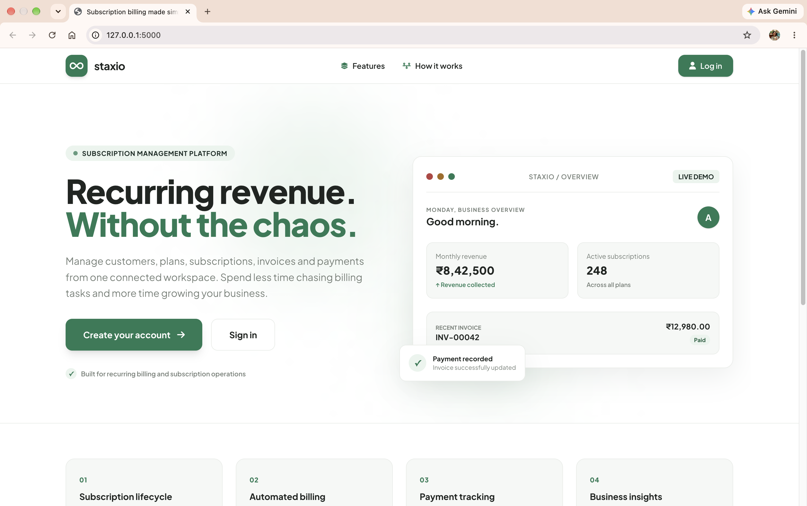
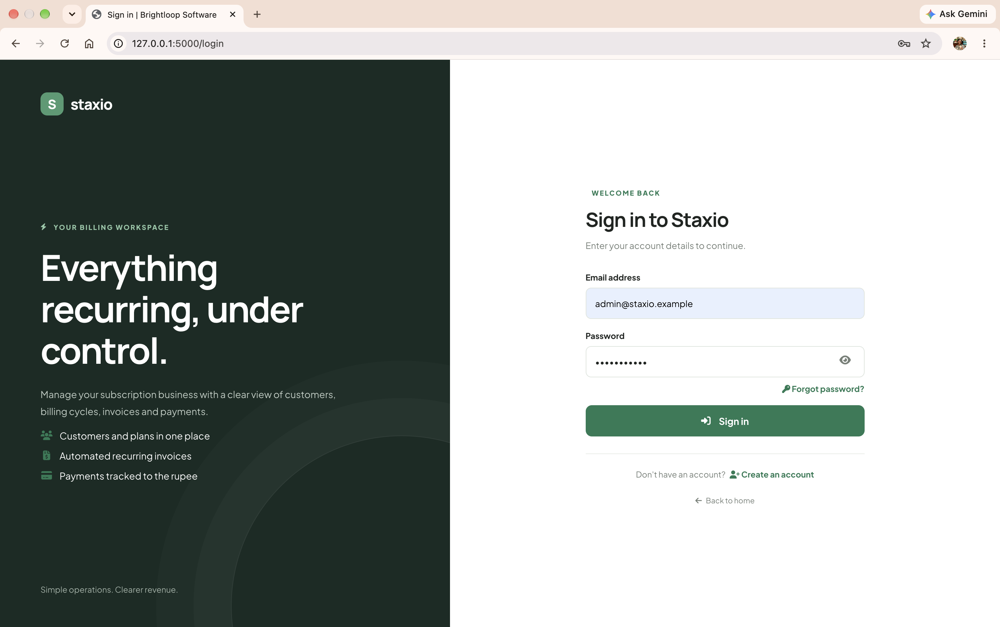
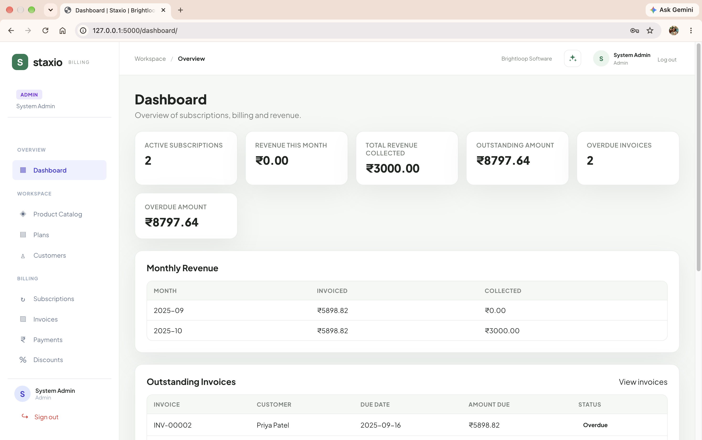
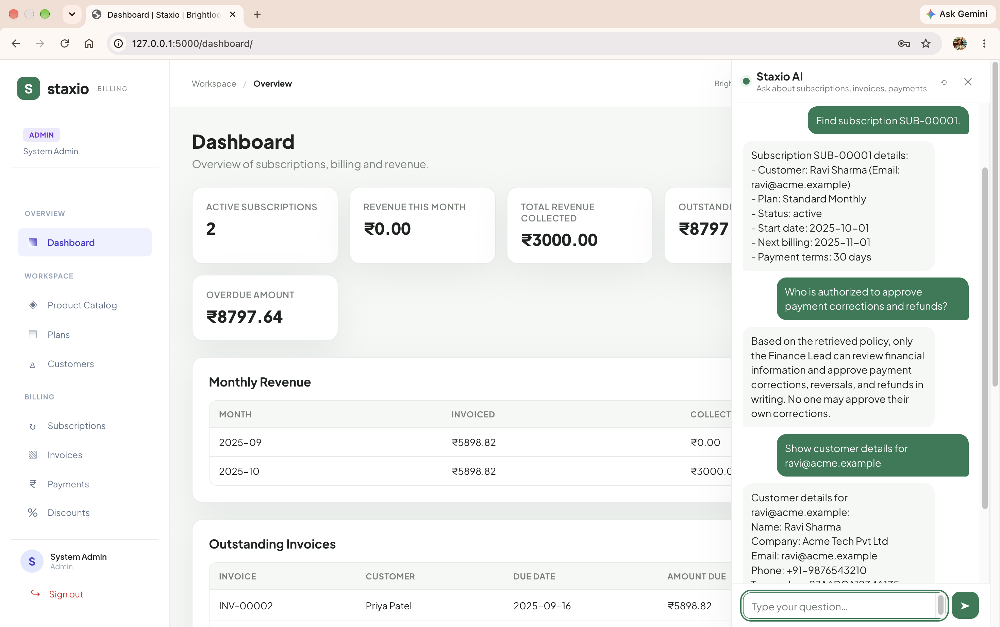
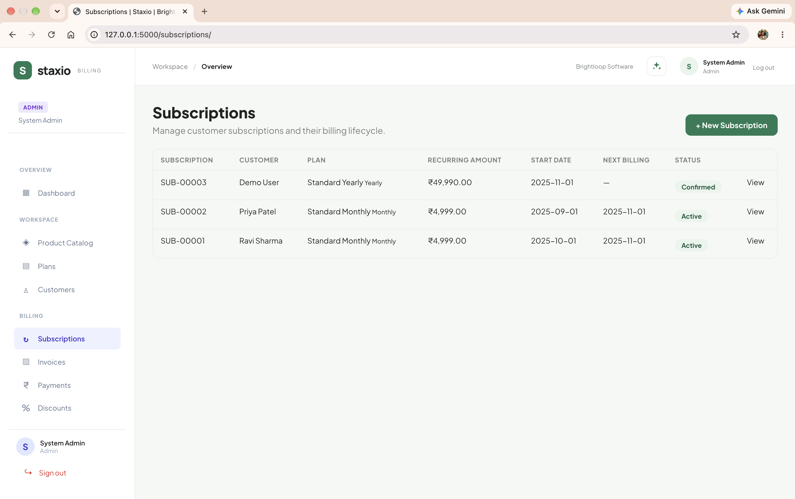
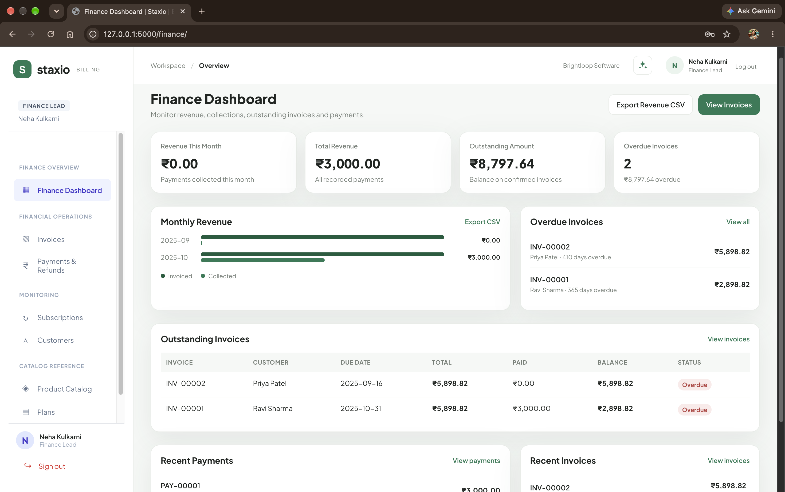
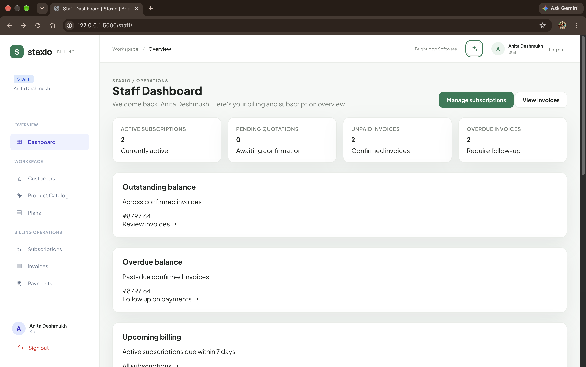
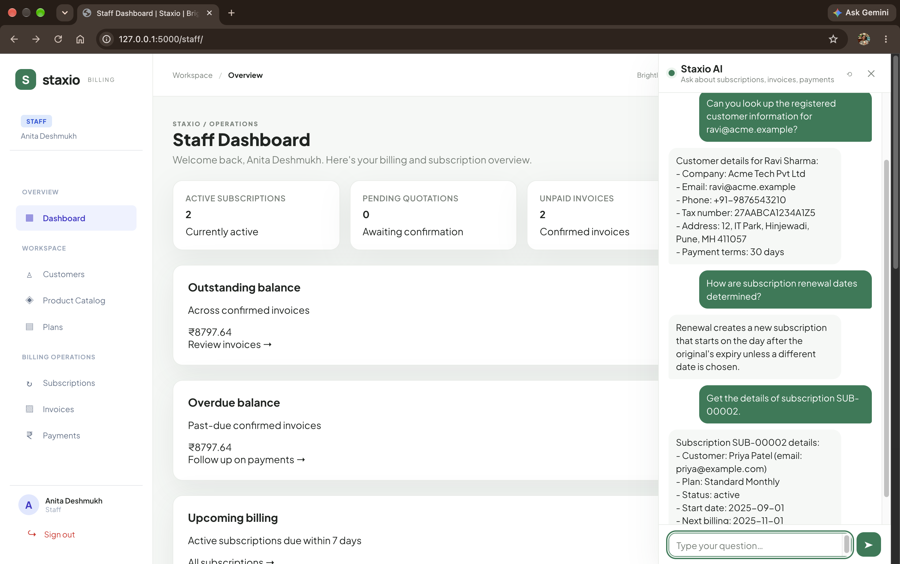
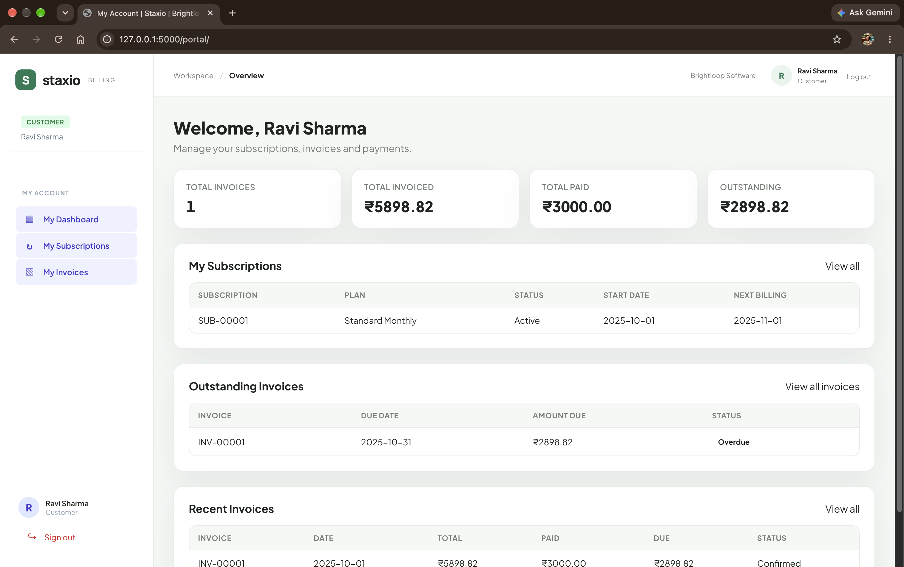

## Problem Statement

Brightloop Software manages a subscription-based business offering monthly and yearly plans, product add-ons, and different product variants. Managing the complete subscription lifecycle involves handling customers, products, plans, renewals, invoices, discounts, payments, and revenue reports.

Without a unified and efficient system, these operations can become time-consuming and error-prone. Subscription records may be scattered across spreadsheets, renewals can be missed, invoices require manual preparation, payments are difficult to reconcile, and revenue reports take significant effort to generate.

Alongside these operational challenges, employees need quick access to company policies and accurate business information. Finding policy details or retrieving specific customer, subscription, invoice, and payment records can require navigating multiple sections of the platform.

The challenge is to improve this workflow by introducing intelligent assistance that allows internal employees to interact with the subscription management system using natural language, obtain policy-based answers, and retrieve relevant live business data securely according to their roles.

---

## Proposed Solution

StaxioAI provides a centralized conversational interface that allows internal users to retrieve business information and understand company policies without manually navigating multiple sections of the subscription management platform.

A fine-tuned DistilBERT model classifies incoming queries into four intent categories. Based on the predicted intent, the system routes requests through one of four pipelines:

- **Knowledge Queries:** Uses Retrieval-Augmented Generation with ChromaDB to retrieve relevant company policies and generate grounded responses.
- **Data Queries:** Uses Qwen2.5-3B-Instruct to select an appropriate read-only database tool and retrieve actual business records.
- **General Queries:** Handles greetings and questions about the assistant's capabilities.
- **Out-of-Scope Queries:** Identifies unrelated requests and responds with appropriate refusals.

Role-based tool access ensures that users can retrieve only the business information permitted for their authenticated role.

### Key Features

- **Intelligent Intent Classification:** Fine-tuned DistilBERT identifies user intent and routes queries to the appropriate pipeline.
- **Policy-Based RAG:** Retrieves relevant company policies using sentence-transformer embeddings and ChromaDB.
- **Natural Language Database Queries:** Uses Qwen2.5-3B-Instruct to select and execute authorized read-only database tools.
- **Role-Based Access Control:** Provides different database capabilities for Administrators, Finance Leads, and Staff.
- **Conversational Interface:** Integrated AI chat sidebar for interacting with Staxio directly.
- **Out-of-Scope Detection:** Handles unrelated requests without executing business tools.

## Unique Selling Points (USPs)

- **AI-Powered Policy Assistance:** Answers employee questions about company policies and business rules using RAG.
- **Intelligent Database Interaction:** Understands user requests and executes relevant authorized tools to fetch live data from the database.
- **Role-Based Access:** Ensures users can access only the information permitted for their roles.

---

## Technology Stack

| Component | Technologies |
|---|---|
| Frontend | HTML, CSS, JavaScript, Jinja2 |
| Backend | Python, Flask |
| Database | SQLite |
| Intent Classification | DistilBERT |
| Generative Language Model | Qwen2.5-3B-Instruct|
| RAG Framework | LangChain |
| Embedding Model | sentence-transformers/all-MiniLM-L6-v2 |
| Vector Database | ChromaDB |
| Model Framework | PyTorch, Hugging Face Transformers |
| Version Control | Git, GitHub |

---

## Screenshots



















---

## Local Setup

### 1. Clone the Repository

```bash
git clone https://github.com/TanmayKhomane13/Staxio--Odoo-Make-a-ton-9.0-Round-1-Virtual-Hackathon
cd [PROJECT_DIRECTORY]
```

### 2. Create a Virtual Environment

```bash
python -m venv venv
```

Activate the environment:

**Windows**

```bash
venv\Scripts\activate
```

**Linux / macOS**

```bash
source venv/bin/activate
```

### 3. Install Dependencies

```bash
pip install -r requirements.txt
```

### 4. Download Fine-Tuned Model Weights

StaxioAI uses two fine-tuned models. Their adapter weights are hosted on Hugging Face.

**Download the fine-tuned model weights:**

- **Intent Classification Model:** StaxioAI Intent Router LoRA Adapter — https://huggingface.co/TanmayKhomane13/StaxioAI_Intent_Router
- **Generative Language Model:** StaxioAI GenLLM LoRA Adapter — https://huggingface.co/TanmayKhomane13/StaxioAI_GenLLM_LoRA_Adapter

Place the downloaded model directories inside `ai_models/`:

```text
project/
└── ai_models/
    ├── StaxioAI_Intent_Router_LoRA/
    └── StaxioAI_v1/
```

**Important:** Ensure that both adapter directories contain their required model configuration and weight files before starting the application.

The base models are:

- `distilbert-base-uncased`
- `Qwen/Qwen2.5-3B-Instruct`

The embedding model is:

- `sentence-transformers/all-MiniLM-L6-v2`

Ensure the required base models and embedding model are available locally or can be downloaded.

### 5. Set Up the Knowledge Base

Ensure the ChromaDB vector store is available in the project directory:

```text
project/
└── vector_store/
    └── chroma_db/
```

The vector store contains embeddings generated from Brightloop Software's company policies and business rules.

If it is not included in the repository, generate it using the provided knowledge-base creation script before launching the application.

### 6. Seed the Database with Initial Demo Data

Run the seed script to populate the SQLite database with initial demonstration data, including sample customers, subscriptions, invoices, payments, and other required records.

```bash
python seed_demo.py
```
### 7. Run the Application

Start the Flask application using the project's entry-point script:

```bash
python run.py
```

Open the local application in your browser using the address displayed by Flask.

---
## Team Members

| Name | Role | Contribution |
|---|---|---|
| **Tanmay Khomane** | Team Lead & AI/ML Engineer | AI architecture, fine-tuning, RAG pipeline, LLM integration and team coordination |
| **Sharvari Kinge** | UI/UX Designer | UI/UX design |
| **Kaustubh Bag** | Backend & Database Engineer | Backend development and database management |
| **Sainath Tambalge** | Frontend Developer | Frontend development and UI implementation |

---

## Project Links

- **GitHub Repository:** https://github.com/TanmayKhomane13/Staxio--Odoo-Make-a-ton-9.0-Round-1-Virtual-Hackathon
- **Demo Video:** https://drive.google.com/drive/u/0/folders/1TlRjH1pcIp9biyYuC9qLfH0fSa7MJFwg

---

**Developed for Odoo × Make-A-Ton 9.0 Round 1 Virtual Hackathon**